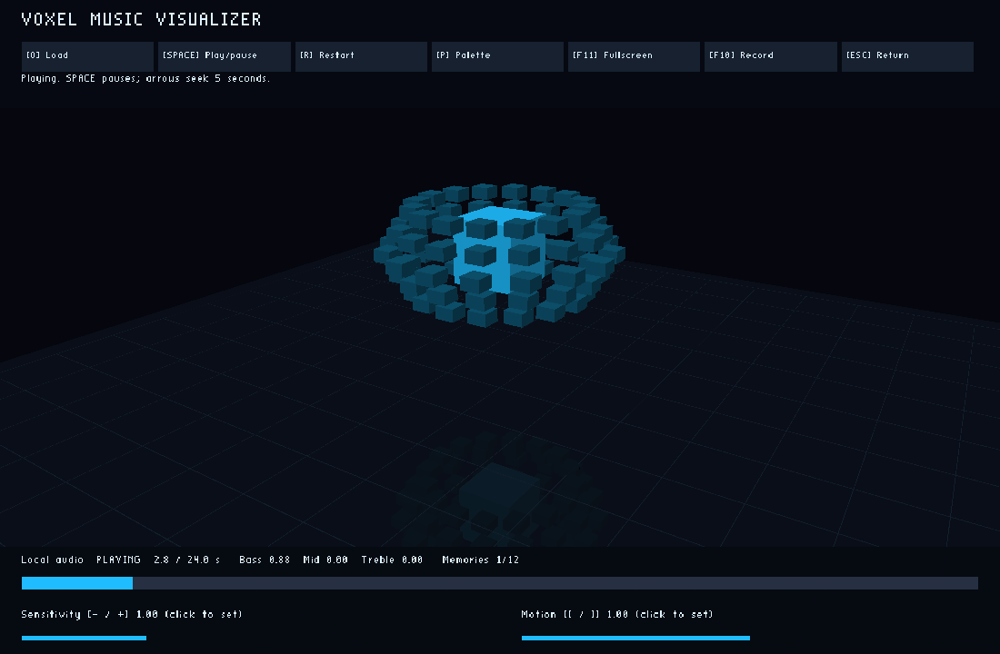
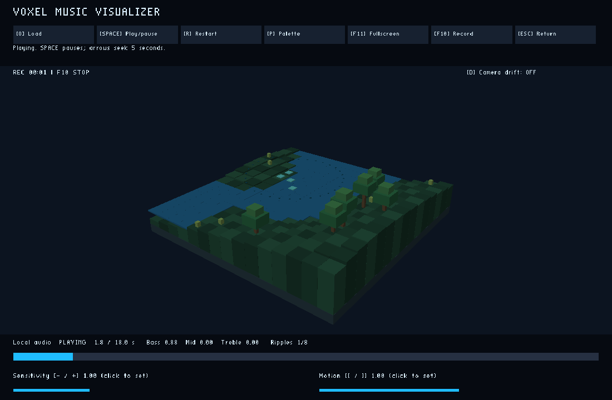
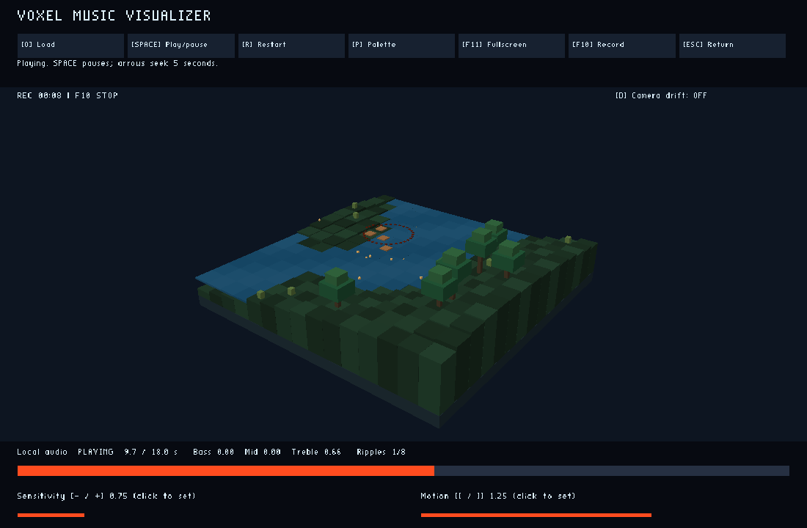

# Living landscape validation

Local evidence, pending controller publication. Implementation and local follow-up fixes are saved. Hosted exact-head checks and the real 30-minute soak remain pending before review. Physical GPU and audible speaker qualification remain pending and gate stable rollout claims.

## Platform and settings

Linux x86_64, Java 25.0.3, inherited assigned X11 display and XAUTHORITY; llvmpipe (LLVM 15.0.6, 256 bits); OpenAL Soft null output; isolated synthetic profiles inside this feature worktree. No personal audio or account data was used. Native desktop client; browser playtesting does not apply. Hosted checks target Java 17.

1100×720, 48-degree field of view, cyan palette, sensitivity 1, motion 1, drift off. Benchmark vsync off; lifecycle run requests vsync and tests fullscreen separately. Final landscape: 15×15 columns, deterministic groves and grass, lake, one instanced box draw. Camera is (17,15,22) looking toward (0,1,0). The original scene uses its original default camera and geometry. Density was refined from 25×25 through 19×19 to meet the same-resolution budget.

## Executed checks

Playtest: `python3 deploy/run_music_smoke.py --display "$DISPLAY"` passed on the final implementation. Actual X11 keys and the production file chooser exercised launch, invalid-file recovery, WAV playback, bass/mid/high responses, live fireflies, beat trails, all-pool seek reset, pause/frozen scene/resume, zero motion, sensitivity, palettes, optional drift, fullscreen, natural completion/calm, quiet audio, replacement, exit and relaunch. Screenshots were inspected: a recognizable terrain/lake/grove scene, roots touching terrain, sparse visible fireflies and fading trails. The interrupted broader regression is listed separately below.

`python3 deploy/check_music_media.py --prefix landscape-live` decoded all 233 frames of the final production F10 H264 MP4: 2742106 bytes, 18.409 seconds, 1100×720. Metadata frame count matched; first/last images differed. The actual decoded contact sheet was inspected. Recording includes bass, mids, highs, beats and natural decay into silence/completion. This is fresh implementation media; publication remains pending.

- `mvn -q -Dmaven.repo.local=target/maven-cache -DargLine="-Djava.io.tmpdir=$PWD/target/tmp" -Dtest=MusicAnalysisTest,MusicLandscapeTest,MusicMp3Test,SandboxIdentityTest,ControlsTest test package`: 24 tests, zero failures/errors. Exact band attack/decay times, mono/stereo/antiphase and MP3 decoding, controls and identity regressions passed. The first attempt hit read-only `/tmp`; the successful run uses `target/tmp`. Updated tests allow the specified slower bass decay and account for the existing 0.0001 envelope gate in low-level channel comparisons.
- `MusicLandscapeTest`: 30 simulated minutes of maximum inputs saturated all three pools, kept aggregate displacement bounded, then expired every effect. Pause froze state; reset cleared history; zero motion returned the base surface. This is not the required wall-clock soak.
- `python3 deploy/run_landscape_comparison.py --display "$DISPLAY"`: all three alternating baseline/landscape pairs met the 10% median and p95 budget. Each run lasted 20 seconds, with the first 5 seconds discarded, using the same original stereo fixture (100/1000/6000 Hz and pulses during the measured window). Baseline source is the recorded original Git head in `landscape-source-manifest.json`; the script preserves it after feature commits.
- Java 17 compilation of the lifecycle and soak harnesses passed. Python harness compilation passed. The hosted entry point rejected an intentionally mismatched source before launching any native command.

| Pair | Baseline median / p95, ms | Landscape median / p95, ms | Both within 10% |
| --- | --- | --- | --- |
| 1 | 7.117 / 9.347 | 7.388 / 10.271 | True |
| 2 | 8.391 / 12.116 | 6.807 / 9.018 | True |
| 3 | 8.936 / 11.511 | 6.366 / 8.551 | True |

All three final trials also meet the 10% limits against their corresponding original pre-edit timings in `landscape-baseline-1.json` through `landscape-baseline-3.json`. The alternating pairs above additionally reproduce the original source on the current host with the same resource instrumentation.

Earlier exploratory timings and rejected density/fragment-shader draft results remain in separately named reports. Shared VPS timing varies substantially, so the final comparison alternates the two sources. These measurements do not qualify a physical GPU. Final benchmark mesh residency was 148752 bytes in every run, including the fixed 147456-byte instance buffer, versus 1296 bytes for the original cube. CPU box staging is another fixed 147456 bytes. Heap/RSS snapshots are recorded in the reports; they do not prove absence of long-term resource growth.

## Bounds and behavior

Bass 150/900 ms, mids 100/600 ms, highs 40/350 ms attack/decay. Lighting eases over 5 seconds on attack and 10 seconds on decay. Global terrain displacement, including all overlapping beats, stays below 0.18708 units (8% of the actual 2.33849-unit base height range); default motion bounds it at 0.09354. Roots and terrain share one integer-centered surface sample. Vegetation placement uses base height, so waves cannot create/delete trees.

Fixed pools recycle oldest slots: 8 ripples/6 seconds, 256 fireflies/8 seconds, 128 illuminated trail elements/20 seconds. The renderer has a fixed 4096-box cap. Pause freezes visible state and ages. Seek/replacement clear pools and analysis; Space restarting a completed track clears history too. Atmosphere stays continuous across seeking. Completion decays naturally; zero motion suppresses waves, rhythmic movement, particles and drift.

`python3 deploy/run_music_mp3_smoke.py --display "$DISPLAY" --evidence-prefix landscape-mp3` passed on the final packaged client: invalid-file recovery, production chooser, CBR stereo and VBR mono playback, pause, paused/clamped keyboard seeks, resume, restart, gain/motion/palette controls, WAV replacement and audio/window release. Its fresh F10 MP4 is 1212901 bytes. Physical speaker output was not tested.

## Images and recording

Original pre-edit VPS scene:

Final implementation, tested bass and highs:

[Natural all-effect expiry screenshot](landscape-live-expired.png), [Final F10 recording](landscape-live.mp4) and [decoded contact sheet](landscape-live-video-contact.png). All are pending controller publication.

## Native integration status

Playtest: `python3 deploy/run_music_regressions.py --display "$DISPLAY" --evidence-prefix landscape-regression` exercised actual `Main.main` catalog selection, Music launch/return/relaunch and preserved City/Sandbox port defaults without an account or network request. Catalog passed. An earlier pre-rebase run ended with signal 143. After rebase, the same command passed catalog, Sandbox and City with exit code 0 for all three. Fresh sanitized result files are saved. Those integration checks preceded the local renderer-only fade/placement fix; the music lifecycle and MP3 checks were repeated after that fix. Hosted qualification repeats the full integration on the published source.

## Pending qualification

The new scoped feature-push workflow checks an exact SHA, runs native lifecycle/MP3/navigation, decodes F10 media, alternates timing trials, then plays an original 1800-second 8 kHz mono fixture. It samples heap/RSS and tracked mesh bytes once per minute, checks live caps/GL errors and resource release, and uploads only synthetic evidence. Partial reports are explicitly not passes. A passed hosted receipt exists only after all commands pass. A developer must inspect the returned media and resource trends before claiming acceptance.

After controller synchronization with master, audit the full diff against the supplied review base. Repeat affected checks and capture media if source changes. Intended deletions are the old core, mirrored reflection/grid and three-second trace renderer; no unrelated source or historical media deletion is intended.

## Prior rebase recovery against the recorded review base

Review base: `8c68a1cd72ec3f344711ef721cdcaffd86c45638`. The current conflict was only `dashboard/progress.json`. Combined the landscape entry with the current branch's full dashboard, preserving every existing entry and release metadata, including Hub preview registration and Music MP3. JSON parsing and entry-preservation assertions passed. No tracked file deletions appear against the review base. Intended code removals remain the obsolete core/reflection/grid/trace renderer described above; no unrelated feature removal is intended.

At the recovery handoff, conflict markers were removed and the unmerged index was left for controller staging and continuation. No Git continuation, commit, push or publication was performed. The controller has since finished the rebase at `34a343384ca3deffe4ef3b8acf829c83b6e6d2fd`. Fresh final-source results supersede the earlier native media and test reports. The 1800-second hosted soak and physical GPU/audio qualification remain pending.

## Final source validation after recovery

Rebased source base: `34a343384ca3deffe4ef3b8acf829c83b6e6d2fd`; the fade/placement follow-up is a local, uncommitted change. Current tested source hashes are recorded in `landscape-source-manifest.json`. Review base: `8c68a1cd72ec3f344711ef721cdcaffd86c45638`. All preserved measured source fingerprints matched immediately after rebase. The audit then found an opaque trail tile could remain until expiration. Trails now shrink as they dim, and trails/rings share the visible cell top, including water only where water is actually drawn. Fresh Maven tests/package, native WAV and MP3 lifecycle runs and full F10 decode passed after that fix. The native run also waited past the 20-second lifetime without seeking/replacement and confirmed every pool empty; its fresh `landscape-live-expired.png` was inspected. Timing was repeated after the fix; see the current performance report. The current contact sheet was inspected.

The full proposed diff was audited against the review base. Changes are limited to the landscape scene, its analysis/render support, scoped test workflow/harnesses, documentation, progress entry and sanitized landscape evidence. Every review-base dashboard entry and other metadata remains unchanged. There are no tracked file deletions. Intended code removals are only the obsolete Resonance Core, reflection/grid and trace renderer. Existing MP3 code, controls, application integration and other merged game features remain intact.

The hosted workflow now explicitly installs ImageMagick, required by the existing Sandbox/City screenshot harness. That provisioning change is pending hosted execution. The hosted harness now exports fresh, sanitized unit counts tagged with its checked source SHA, rather than treating committed local unit evidence as a hosted result. The exporter was exercised with the actual local suite reports and an isolated output sink. Source-mismatch rejection and Python compilation passed. The actual 1800-second soak and physical GPU/audio qualification remain pending. Local synthetic media is pending controller publication.

## Reconciliation after second master integration

Current source base: `63cc43a80b0d3eef5543f32b58f1d5c1133477f7`. No production Java or shader changes relative to published head `384322d7fa9b83745b20db78d5ef3073aa25f67d`. Preserved both Hub packaging and landscape progress. No tracked deletions against recorded review base. Focused Maven tests/package rerun: 24 tests, zero failures/errors. An early regression compilation attempt preceded completed production compilation and failed; rerun follows the successful package.

Old hosted results are now inspected and separately saved as `landscape-hosted-384322-*`. See `landscape-hosted-384322-review.md` for measured soak, resources, media and performance. Native run failed overall on navigation; stale committed regression PASS reports cannot qualify that run. Improved regression harness removes only its named prior reports, records source/scenario exit codes including compilation and timeout, copies only fresh named reports, hashes output and marks completion only after all scenarios pass. Physical GPU/audio remains pending; no stable rollout claim. Final-source hosted validation remains required.

Playtest: `python3 deploy/run_music_regressions.py --display "$DISPLAY" --evidence-prefix landscape-regression` passed on the rebased client with the fixture fix. Expected catalog launch/return/relaunch, Sandbox input/crafting/inventory/HUD and City entry/tool/cancel/walking checks; observed compile/catalog/Sandbox/City exit 0. `landscape-regression-status.json` is complete and hashes each fresh sanitized report. The failed earlier stack-move check was a test-state error: closing inventory retains the Recipe Book tab. The fix uses actual Escape to return to slots; no product behavior was changed.

Playtest: `python3 deploy/run_music_smoke.py --display "$DISPLAY"` passed again on the rebased packaged client. Expected/observed: invalid-load recovery; rhythmic, sustained, quiet and silent fixtures; native playback; pause freezes scene; resume; seeking/replacement/restart clear pools; drift/motion/sensitivity/palette/fullscreen; natural completion and expiry; exit/relaunch and audio/window release. `python3 deploy/check_music_media.py --prefix landscape-live` passed: fresh F10 H264, 2121375 bytes, 177 decoded frames, 18.951 seconds, 824x540 encoded size from a 1100x720 client. Inspected treble screenshot and actual decoded contact sheet: rooted landscape, sparse fireflies, beat trails and transition to calm remain readable. All temporary history expires naturally in the smoke test. Local Linux amd64 llvmpipe LLVM 15.0.6 256-bit, assigned inherited X11 display, OpenAL null, isolated synthetic profile. Physical GPU and audible speakers remain untested. Fresh media is pending controller publication.

Final-source hosted validation is required after publishing these harness and evidence changes. The historical hosted soak/performance are not relabeled as the resulting head. No source changes to the renderer/audio pipeline were needed during this reconciliation.

## Review correction: preserve Asset Manager

Earlier “no tracked deletions” claims used an obsolete review base and did not establish preservation against current master `4a0bbd6a`. That audit was insufficient. Reviewer identified removed Asset Manager implementation/resources/tests/evidence and Main launcher/intake paths; this blocks approval. The preserved rebase now includes those current-master features. Checked all Asset Manager-named paths and Main byte-for-byte against `4a0bbd6a`: identical. No deletion is intended for that feature. Resolved the current progress timestamp conflict while preserving other dashboard entries and release data. Controller must stage and continue rebase before final-source tests. After recovery, rerun Asset Manager integration/native launcher/intake and landscape navigation checks; prior landscape passes do not qualify restored navigation. Physical GPU/audio remains pending.
